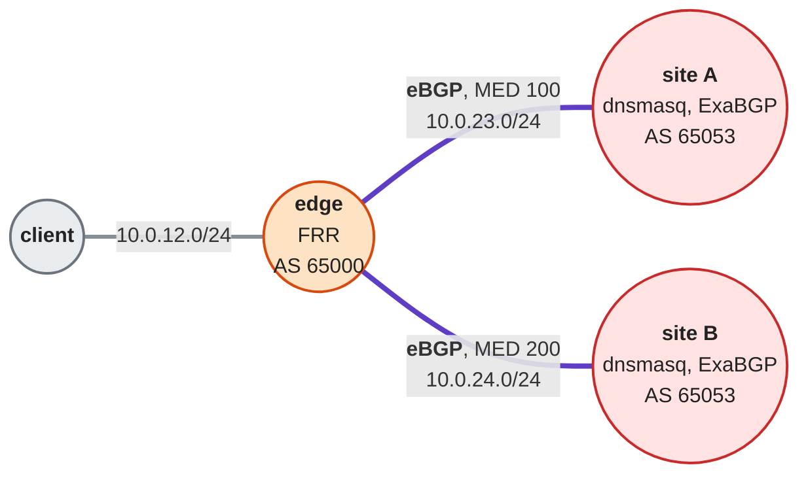

This lab keeps a DNS service reachable when a whole site fails, without a
load balancer and without touching the clients. Both sites answer on the
same "anycast" IP address, and BGP sends the clients to one of them. On each
site, ExaBGP's healthcheck asks the local DNS server a question every second,
and announces the anycast address only while it gets an answer:

- when the DNS daemon of a site stops answering, the site withdraws its
  route within a few seconds and the clients move to the other site;
- when a whole site goes dark and cannot withdraw anything, the edge router
  drops its BGP session after the 9 s hold time and does the same.

The same setup works for any service that can be health-checked: NTP, a web
server, a syslog collector, an API.

## Overview

### Network diagram



Every IPv4 subnet 10.0.XY.0/24 has an IPv6 twin 2001:db8:XY::/64. Both sites
carry the anycast addresses 192.0.2.53/32 and 2001:db8:53::53/128 on their
`lo1` interface.

| Router | Role |
|--------|------|
| client | DNS client, default route via the edge |
| edge | FRR, eBGP to both sites, one IPv4 and one IPv6 session each |
| site A | dnsmasq answering `site.anycast.lab TXT "site-A"`, ExaBGP announcing the anycast addresses with MED 100 |
| site B | Same as site A, answering `"site-B"`, MED 200 |

The two sites use the same AS and different MEDs, so the edge prefers site A
while both answer. The TXT record shows which site answered.

## Setting up the lab

### Downloading BSD Router Project images

Download the BSDRP serial image from SourceForge.

### Download lab scripts

More information on these BSDRP lab scripts is available on
[How to build a BSDRP router lab](how-to-build-a-bsdrp-router-lab.md).

Start the lab with four routers, configured automatically by `labconfig`:

```
tools/BSDRP-lab-bhyve.sh -i BSDRP-full-amd64.img -n 4 -r anycast
```

The VMs are fully meshed; this lab only uses the links from the edge (VM2)
to the client (VM1) and to the two sites (VM3 and VM4).

## Router configuration

Each block below is what `labconfig anycast_vm<N>` applies. Replace `em`
by `vtnet` in the interface names on bhyve (`labconfig` does it for you).

### Client (VM1)

```
sysrc hostname=client \
 gateway_enable=NO \
 ipv6_gateway_enable=NO \
 ifconfig_em0="inet 10.0.12.1/24" \
 ifconfig_em0_ipv6="inet6 2001:db8:12::1 prefixlen 64" \
 defaultrouter=10.0.12.2 \
 ipv6_defaultrouter=2001:db8:12::2
config save
service hostname restart
service netif restart
service routing restart
```

### Edge router (VM2)

```
sysrc hostname=edge \
 ifconfig_em0="inet 10.0.12.2/24" \
 ifconfig_em0_ipv6="inet6 2001:db8:12::2 prefixlen 64" \
 ifconfig_em1="inet 10.0.23.2/24" \
 ifconfig_em1_ipv6="inet6 2001:db8:23::2 prefixlen 64" \
 ifconfig_em2="inet 10.0.24.2/24" \
 ifconfig_em2_ipv6="inet6 2001:db8:24::2 prefixlen 64" \
 frr_enable=YES
cat > /usr/local/etc/frr/frr.conf <<EOF
frr defaults traditional
hostname edge
log syslog
!
router bgp 65000
 bgp router-id 10.0.0.2
 no bgp ebgp-requires-policy
 neighbor SITES4 peer-group
 neighbor SITES4 remote-as 65053
 neighbor SITES4 timers 3 9
 neighbor SITES6 peer-group
 neighbor SITES6 remote-as 65053
 neighbor SITES6 timers 3 9
 neighbor 10.0.23.3 peer-group SITES4
 neighbor 10.0.24.4 peer-group SITES4
 neighbor 2001:db8:23::3 peer-group SITES6
 neighbor 2001:db8:24::4 peer-group SITES6
 !
 address-family ipv4 unicast
  no neighbor SITES6 activate
 exit-address-family
 !
 address-family ipv6 unicast
  neighbor SITES6 activate
 exit-address-family
exit
!
EOF
config save
service hostname restart
service netif restart
service frr start
```

The short timers (keepalive 3 s, hold 9 s) bound the failover time when a
whole site disappears. With the default 180 s hold time, clients would wait
three minutes.

### DNS sites (VM3 and VM4)

Site A is shown; site B uses `siteB`, `site-B`, the 10.0.24.0/24 subnet and
`--up-metric 200`.

```
sysrc hostname=siteA \
 gateway_enable=NO \
 ipv6_gateway_enable=NO \
 ifconfig_em1="inet 10.0.23.3/24" \
 ifconfig_em1_ipv6="inet6 2001:db8:23::3 prefixlen 64" \
 defaultrouter=10.0.23.2 \
 ipv6_defaultrouter=2001:db8:23::2 \
 cloned_interfaces=lo1 \
 ifconfig_lo1="inet 192.0.2.53/32" \
 ifconfig_lo1_ipv6="inet6 2001:db8:53::53 prefixlen 128" \
 dnsmasq_enable=YES \
 exabgp_enable=YES
cat > /usr/local/etc/dnsmasq.conf <<EOF
no-resolv
no-hosts
bind-interfaces
listen-address=127.0.0.1,192.0.2.53,2001:db8:53::53
txt-record=site.anycast.lab,"site-A"
address=/www.anycast.lab/192.0.2.80
EOF
cat > /usr/local/etc/exabgp/exabgp.conf <<EOF
process anycast-dns {
	run /usr/local/bin/exabgp-healthcheck --name anycast-dns --no-ip-setup --ip 192.0.2.53/32 --ip 2001:db8:53::53/128 --withdraw-on-down --up-metric 100 --interval 1 --rise 2 --fall 2 --timeout 1 --cmd "host -W 1 -t TXT site.anycast.lab 127.0.0.1";
	encoder text;
}
neighbor 10.0.23.2 {
	router-id 10.0.0.3;
	local-address 10.0.23.3;
	local-as 65053;
	peer-as 65000;
	family {
		ipv4 unicast;
	}
	api {
		processes [ anycast-dns ];
	}
}
neighbor 2001:db8:23::2 {
	router-id 10.0.0.3;
	local-address 2001:db8:23::3;
	local-as 65053;
	peer-as 65000;
	family {
		ipv6 unicast;
	}
	api {
		processes [ anycast-dns ];
	}
}
EOF
config save
service hostname restart
service netif restart
service routing restart
service dnsmasq start
service exabgp start
```

The healthcheck options:

- `--cmd`: the check, a real DNS query to the local dnsmasq. Any command
  that exits 0 when the service is healthy works.
- `--rise 2 --fall 2 --interval 1`: two successes in a row to announce, two
  failures in a row to withdraw, one check per second.
- `--withdraw-on-down`: withdraw the route when the check fails. Without it,
  the healthcheck keeps the route and only raises the MED.
- `--up-metric`: the MED announced while healthy. The second address gets
  the next value (101 for the IPv6 one on site A).
- `--no-ip-setup`: the healthcheck adds missing addresses with the Linux
  `ip` command, which FreeBSD does not have. `lo1` already carries them.

The healthcheck announces both addresses to both neighbors; each session
only carries its own address family.

## Testing

### Normal operation

Both sites announce the anycast address, and the edge picks site A on MED:

```
[root@edge]~# vtysh -c "show ip bgp 192.0.2.53/32"
BGP routing table entry for 192.0.2.53/32, version 1
Paths: (2 available, best #1, table default)
  Advertised to peers:
  10.0.23.3 10.0.24.4
  65053
    10.0.23.3 from 10.0.23.3 (10.0.0.3)
      Origin IGP, metric 100, valid, external, best (MED)
      Last update: Wed Nov 18 12:34:51 2026
  65053
    10.0.24.4 from 10.0.24.4 (10.0.0.4)
      Origin IGP, metric 200, valid, external
      Last update: Wed Nov 18 12:34:56 2026
```

The client asks the anycast address, and site A answers, over IPv4 and IPv6:

```
[root@client]~# host -t TXT site.anycast.lab 192.0.2.53 | grep descriptive
site.anycast.lab descriptive text "site-A"
[root@client]~# host -t TXT site.anycast.lab 2001:db8:53::53 | grep descriptive
site.anycast.lab descriptive text "site-A"
```

### The DNS daemon of site A fails

Stop dnsmasq on site A, then query once per second from the client:

```
[root@siteA]~# service dnsmasq stop
```

```
12:35:28
12:35:29
12:35:32
site.anycast.lab descriptive text "site-B"
12:35:33
site.anycast.lab descriptive text "site-B"
```

About 4 seconds without an answer: two failed checks, then the withdrawal.
The edge only has site B's path left:

```
[root@edge]~# vtysh -c "show ip bgp 192.0.2.53/32" | grep -E 'Paths|best'
Paths: (1 available, best #1, table default)
      Origin IGP, metric 200, valid, external, best (First path received)
```

Start dnsmasq again: after two good checks, site A takes the traffic back
(3 seconds here), over IPv4 and IPv6:

```
12:35:45 (dnsmasq started on site A)
12:35:47
site.anycast.lab descriptive text "site-B"
site.anycast.lab descriptive text "site-B"
12:35:48
site.anycast.lab descriptive text "site-A"
site.anycast.lab descriptive text "site-A"
```

### Site A goes dark

Bring site A's uplink down. The site can no longer withdraw anything, so
the edge only notices when the BGP hold time (9 s) expires:

```
[root@siteA]~# ifconfig vtnet1 down
```

```
12:35:59 (uplink down)
12:36:00
12:36:03
12:36:06
site.anycast.lab descriptive text "site-B"
```

About 7 seconds without an answer. When the uplink comes back, the BGP
sessions re-establish and site A answers again.

### Automated test

`tools/regression-test.sh <image> anycast` runs the checks above, including
both failures and the recoveries.
