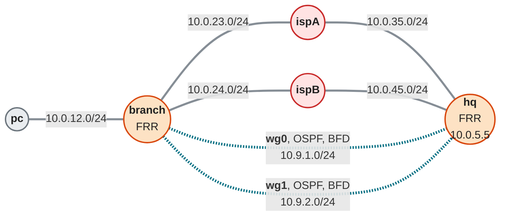

This lab connects a branch office to its headquarters through two ISPs at
the same time, without mpd5 or MLVPN:

- one WireGuard tunnel per ISP, so the ISPs only carry encrypted IPv4
  between the two public addresses, and IPv6 travels inside the tunnels;
- OSPF and OSPFv3 over both tunnels with the same cost, so FRR installs
  equal-cost multi-path (ECMP) routes and the flows share both links;
- BFD on every adjacency: a tunnel interface stays up when its ISP fails,
  so BFD is what notices the silence and removes the path in under a
  second.

Unlike link aggregation (ML-PPP, MLVPN), ECMP keeps each flow on one path:
no packet reordering, but a single TCP connection never goes faster than
one link. Many flows, as from a whole office, use both.

## Overview

### Network diagram



The PC LAN 10.0.12.0/24 has an IPv6 twin 2001:db8:12::/64, and the
tunnels 2001:db8:91::/64 and 2001:db8:92::/64. HQ's services sit on its
`lo1`: 10.0.5.5 and 2001:db8:5::5. The ISP links are IPv4 only.

| Router | Role |
|--------|------|
| pc | Branch workstation, default route via the branch router |
| branch | Branch router: wg0 over ISP-A, wg1 over ISP-B, OSPF, OSPFv3 and BFD on both |
| ispA, ispB | Two ISPs, plain IPv4 forwarding |
| hq | Headquarters router, same tunnels and routing as the branch |

## Setting up the lab

### Downloading BSD Router Project images

Download the BSDRP serial image from SourceForge.

### Download lab scripts

More information on these BSDRP lab scripts is available on
[How to build a BSDRP router lab](how-to-build-a-bsdrp-router-lab.md).

Start the lab with five routers, configured automatically by `labconfig`:

```
tools/BSDRP-lab-bhyve.sh -i BSDRP-full-amd64.img -n 5 -r branch
```

The VMs are fully meshed; this lab only uses the links drawn above.

## Router configuration

Each block below is what `labconfig branch_vm<N>` applies. Replace `em`
by `vtnet` in the interface names on bhyve (`labconfig` does it for you).
The WireGuard keys are lab keys: generate your own with `wg genkey`.

### PC (VM1)

```
sysrc hostname=pc \
 gateway_enable=NO \
 ipv6_gateway_enable=NO \
 ifconfig_em0="inet 10.0.12.1/24" \
 ifconfig_em0_ipv6="inet6 2001:db8:12::1 prefixlen 64" \
 defaultrouter=10.0.12.2 \
 ipv6_defaultrouter=2001:db8:12::2
config save
service hostname restart
service netif restart
service routing restart
```

### Branch router (VM2)

Interfaces, the two tunnels, and one host route per ISP to HQ's public
address on that ISP, so each tunnel's encrypted packets leave through its
own ISP:

```
sysrc hostname=branch \
 ifconfig_em0="inet 10.0.12.2/24" \
 ifconfig_em0_ipv6="inet6 2001:db8:12::2 prefixlen 64" \
 ifconfig_em1="inet 10.0.23.2/24" \
 ifconfig_em2="inet 10.0.24.2/24" \
 cloned_interfaces="wg0 wg1" \
 ifconfig_wg0="inet 10.9.1.2/24" \
 ifconfig_wg0_ipv6="inet6 2001:db8:91::2 prefixlen 64 auto_linklocal" \
 ifconfig_wg1="inet 10.9.2.2/24" \
 ifconfig_wg1_ipv6="inet6 2001:db8:92::2 prefixlen 64 auto_linklocal" \
 static_routes="ispa ispb" \
 route_ispa="-host 10.0.35.5 10.0.23.3" \
 route_ispb="-host 10.0.45.5 10.0.24.4" \
 frr_enable=YES \
 frr_daemons="mgmtd zebra staticd bfdd ospfd ospf6d"
```

`if_wg` gets no IPv6 link-local address by default, and OSPFv3 needs one:
hence `auto_linklocal`.

The tunnels, one per ISP. `AllowedIPs` accepts everything, as OSPF decides
what goes through which tunnel. The rc.d `netif` script sources
`/etc/start_if.<interface>` before configuring an interface, which is the
place to load the keys:

```
mkdir -p /usr/local/etc/wireguard
cat > /usr/local/etc/wireguard/wg0.conf <<EOF
[Interface]
PrivateKey = wKzufFch9l+SpPS417DGvSgUbhII6wcTB3ul/tjP7XQ=
ListenPort = 51820

[Peer]
PublicKey = 46I9Wa1Neq3NxsMnQh+1sKjrh0np8EdLhrCoFk78pSg=
Endpoint = 10.0.35.5:51820
AllowedIPs = 0.0.0.0/0, ::/0
PersistentKeepalive = 10
EOF
cat > /usr/local/etc/wireguard/wg1.conf <<EOF
[Interface]
PrivateKey = wKzufFch9l+SpPS417DGvSgUbhII6wcTB3ul/tjP7XQ=
ListenPort = 51821

[Peer]
PublicKey = 46I9Wa1Neq3NxsMnQh+1sKjrh0np8EdLhrCoFk78pSg=
Endpoint = 10.0.45.5:51821
AllowedIPs = 0.0.0.0/0, ::/0
PersistentKeepalive = 10
EOF
chmod 600 /usr/local/etc/wireguard/wg*.conf
echo "wg setconf wg0 /usr/local/etc/wireguard/wg0.conf" > /etc/start_if.wg0
echo "wg setconf wg1 /usr/local/etc/wireguard/wg1.conf" > /etc/start_if.wg1
```

Flow hashing for forwarded packets (see
[Why net.route.hash_forward](#why-netroutehash_forward)):

```
echo "net.route.hash_forward=1" >> /etc/sysctl.conf
sysctl net.route.hash_forward=1
```

FRR: OSPF and OSPFv3 on both tunnels, BFD on every adjacency, the LAN
announced as passive:

```
cat > /usr/local/etc/frr/frr.conf <<EOF
frr defaults traditional
hostname branch
log syslog
!
interface wg0
 ip ospf network point-to-point
 ip ospf bfd
 ipv6 ospf6 area 0.0.0.0
 ipv6 ospf6 network point-to-point
 ipv6 ospf6 bfd
exit
!
interface wg1
 ip ospf network point-to-point
 ip ospf bfd
 ipv6 ospf6 area 0.0.0.0
 ipv6 ospf6 network point-to-point
 ipv6 ospf6 bfd
exit
!
interface em0
 ipv6 ospf6 area 0.0.0.0
 ipv6 ospf6 passive
exit
!
router ospf
 ospf router-id 10.0.0.2
 passive-interface em0
 network 10.9.0.0/16 area 0.0.0.0
 network 10.0.12.0/24 area 0.0.0.0
exit
!
router ospf6
 ospf6 router-id 10.0.0.2
exit
!
EOF
config save
service hostname restart
service netif restart
service routing restart
service frr start
```

The underlay subnets stay out of OSPF: if HQ's public addresses were
learned through the tunnels, the tunnels would try to run over themselves.

### ISP routers (VM3 and VM4)

ISP-A is shown; ISP-B uses `ispB`, 10.0.24.4/24 and 10.0.45.4/24:

```
sysrc hostname=ispA \
 gateway_enable=YES \
 ipv6_gateway_enable=NO \
 ifconfig_em1="inet 10.0.23.3/24" \
 ifconfig_em3="inet 10.0.35.3/24"
config save
service hostname restart
service netif restart
service routing restart
```

### HQ router (VM5)

The mirror of the branch: its services on `lo1`, the ISP links on `em2`
and `em3`, the peers' addresses swapped:

```
sysrc hostname=hq \
 ifconfig_em2="inet 10.0.35.5/24" \
 ifconfig_em3="inet 10.0.45.5/24" \
 cloned_interfaces="lo1 wg0 wg1" \
 ifconfig_lo1="inet 10.0.5.5/32" \
 ifconfig_lo1_ipv6="inet6 2001:db8:5::5 prefixlen 128" \
 ifconfig_wg0="inet 10.9.1.5/24" \
 ifconfig_wg0_ipv6="inet6 2001:db8:91::5 prefixlen 64 auto_linklocal" \
 ifconfig_wg1="inet 10.9.2.5/24" \
 ifconfig_wg1_ipv6="inet6 2001:db8:92::5 prefixlen 64 auto_linklocal" \
 static_routes="ispa ispb" \
 route_ispa="-host 10.0.23.2 10.0.35.3" \
 route_ispb="-host 10.0.24.2 10.0.45.4" \
 frr_enable=YES \
 frr_daemons="mgmtd zebra staticd bfdd ospfd ospf6d"
```

The WireGuard files use HQ's private key
(`GHMb2PUmcrykraEdpeMPAoZMGqxyipzKCBEUue/Xp3U=`), the branch's public key
(`2qxqCFgTol1zqt14XTppz83eG/aLbF0O+kM1PwCkWwk=`) and the endpoints
10.0.23.2:51820 and 10.0.24.2:51821. In `frr.conf`, the router-id is
10.0.0.5, `lo1` replaces `em0` and the network is 10.0.5.5/32. HQ also
sets `net.route.hash_forward=1`, for the traffic it forwards to the branch.

## Why net.route.hash_forward

With several equal-cost routes, FreeBSD picks the next-hop from the
packet's flow hash (`flowid`). A router does not compute it: the
receiving NIC does, with RSS. Here no packet has one:

- bhyve's `virtio-net` has a single queue and stamps every packet with the
  same queue number;
- `if_wg` clears the hash of every packet it decrypts, so even on
  RSS-capable hardware the traffic coming out of a tunnel has none.

Without a hash, every flow takes the first next-hop and the second ISP
stays idle. `net.route.hash_forward=1` (BSDRP 2.4 and later) makes the
router compute a hash of the addresses, protocol and ports of each
forwarded packet that arrives without one; packets that already carry an
RSS hash keep it. It defaults to 0 because it costs a hash per forwarded
packet.

## Testing

### ECMP routes

Each router has two OSPF paths to the other side, one per tunnel:

```
[root@branch]~# vtysh -c "show ip route 10.0.5.5"
Routing entry for 10.0.5.5/32
  Known via "ospf", distance 110, metric 10, best
  Last update 00:01:01 ago
  Flags: Selected
  Status: Installed
  * 10.9.1.5, via wg0, weight 1
  * 10.9.2.5, via wg1, weight 1

[root@branch]~# vtysh -c "show bfd peers brief"
Session count: 4
SessionId  LocalAddress                             PeerAddress                             Status          Profile
=========  ============                             ===========                             ======          =======
367124539  10.9.1.2                                 10.9.1.5                                up              -
4091054727 10.9.2.2                                 10.9.2.5                                up              -
214490437  fe80::5a9c:fcff:fe01:202                 fe80::5a9c:fcff:fe01:505                up              -
2521932787 fe80::5a9c:fcff:fe01:202                 fe80::5a9c:fcff:fe01:505                up              -
```

The kernel holds both next-hops:

```
[root@branch]~# netstat -rn | grep 10.0.5.5
10.0.5.5           10.9.1.5           UGH1            wg0
10.0.5.5           10.9.2.5           UGH1            wg1
```

### Flows spread over both ISPs

The PC sends 256 UDP flows to HQ, one per source port, and the branch
counts the packets leaving through each tunnel:

```
[root@pc]~# for p in $(jot 256 20000); do echo x | nc -u -w0 -p $p 10.0.5.5 9; done
```

| net.route.hash_forward | wg0 (ISP-A) | wg1 (ISP-B) |
|---|---|---|
| 0 | 256 | 0 |
| 1 | 128 | 128 |

IPv6 gives the same result. With only a few flows the split is less even:
eight `iperf3` TCP streams sent 54 MB through wg0 and 29 MB through wg1.

### ISP-A fails

Bring down ISP-A's link to HQ while the PC pings HQ every 100 ms:

```
[root@ispA]~# ifconfig vtnet3 down
```

```
[root@pc]~# ping -i 0.1 -c 150 10.0.5.5
...
150 packets transmitted, 142 packets received, 5.3% packet loss
```

8 lost packets: about 0.8 s, the BFD detection time (3 x 300 ms). wg0 is
still up as an interface, but BFD drops its adjacencies and the branch
keeps one path:

```
[root@branch]~# netstat -rn | grep 10.0.5.5
10.0.5.5           10.9.2.5           UGH1            wg1
```

Only the flows that were using wg0 notice the failure. When ISP-A comes
back, OSPF restores the second path and the flows spread again.

### Automated test

`tools/regression-test.sh <image> branch` runs the checks above: the
tunnels, OSPF, OSPFv3 and BFD state, the ECMP routes on both routers, the
256-flow spread over IPv4 and IPv6, and the ISP-A failure and recovery.
