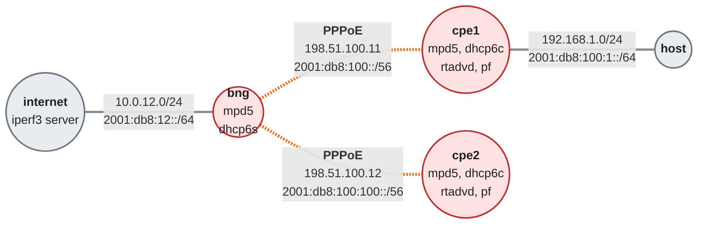

At most broadband ISPs, the subscriber's CPE dials a PPPoE session to a
broadband network gateway (BNG). The session carries both address
families:

- IPv4: the BNG authenticates the login and gives the CPE its public
  address in IPCP; the CPE NATs its LAN behind it;
- IPv6: IPv6CP only brings up link-local addresses. The CPE then asks for
  a prefix with DHCPv6 prefix delegation (RFC 8415), here a /56, takes a
  /64 out of it for its LAN and announces it there. The LAN hosts
  configure their own addresses (SLAAC).

In this lab, BSDRP is both the BNG and the CPEs: `mpd5` for PPPoE on
both sides, WIDE `dhcp6s` and `dhcp6c` for the prefix delegation, and
`rtadvd` on the CPE's LAN. Each subscriber always gets the same IPv4
address and the same /56, also after a redial.

## Overview

### Network diagram



The PPPoE sessions all run over one shared access LAN between the BNG
and the CPEs. The BNG side of every session is 198.51.100.1.

| Router | Role |
|--------|------|
| internet | The rest of the world, with an `iperf3` server |
| bng | PPPoE server, one fixed IPv4 address and /56 per subscriber |
| cpe1, cpe2 | Subscribers' routers: PPPoE client, DHCPv6-PD client, IPv4 NAT |
| host | A host on cpe1's LAN |

## Setting up the lab

### Downloading BSD Router Project images

Download the BSDRP serial image from SourceForge.

### Download lab scripts

More information on these BSDRP lab scripts is available on
[How to build a BSDRP router lab](how-to-build-a-bsdrp-router-lab.md).

Start the lab with five routers and the shared LAN (`-l 1`), configured
automatically by `labconfig`:

```
tools/BSDRP-lab-bhyve.sh -i BSDRP-full-amd64.img -n 5 -l 1 -r bng
```

The VMs are fully meshed; this lab uses the shared LAN (em4) for PPPoE,
the VM1-VM2 link for the internet and the VM3-VM5 link for cpe1's LAN.

## Router configuration

Each block below is what `labconfig bng_vm<N>` applies. Replace `em` by
`vtnet` in the interface names on bhyve (`labconfig` does it for you).

### Internet (VM1)

```
sysrc hostname=internet \
 gateway_enable=NO \
 ipv6_gateway_enable=NO \
 ifconfig_em0="inet 10.0.12.1/24" \
 ifconfig_em0_ipv6="inet6 2001:db8:12::1 prefixlen 64" \
 defaultrouter=10.0.12.2 \
 ipv6_defaultrouter=2001:db8:12::2
iperf3 -s -D
```

### BNG (VM2)

```
sysrc hostname=bng \
 ifconfig_em0="inet 10.0.12.2/24" \
 ifconfig_em0_ipv6="inet6 2001:db8:12::2 prefixlen 64" \
 ifconfig_em4="up" \
 mpd_enable=YES \
 mpd_flags="-b"
```

`/usr/local/etc/mpd5/mpd.conf` accepts PPPoE sessions on the access LAN.
The link and bundle are templates: every session gets its own bundle and
its own `ngN` interface. The peers authenticate with CHAP.

```
default:
	load pppoe_server
pppoe_server:
	create bundle template B
	set ipcp ranges 198.51.100.1/32 198.51.100.0/24
	set bundle enable ipv6cp
	set iface up-script /usr/local/etc/mpd5/if-up.sh
	set iface down-script /usr/local/etc/mpd5/if-down.sh
	create link template L pppoe
	set link action bundle B
	set link disable chap pap eap
	set link enable chap
	set link keep-alive 10 60
	set link mtu 1492
	set link max-children 100
	set pppoe iface em4
	set pppoe service "*"
	set link enable incoming
```

`/usr/local/etc/mpd5/mpd.secret` holds the logins; the third column is
the IPv4 address each one gets:

```
cpe1 "cpe1-secret" 198.51.100.11
cpe2 "cpe2-secret" 198.51.100.12
```

`/usr/local/etc/dhcp6s.conf` delegates a /56 to each CPE. WIDE `dhcp6s`
has no prefix pool: it only delegates a prefix to a client it knows by
its DUID, so each CPE is provisioned with its own DUID (below).

```
host cpe1 { duid 00:03:00:01:02:00:00:00:00:03; prefix 2001:db8:100::/56 infinity; };
host cpe2 { duid 00:03:00:01:02:00:00:00:00:04; prefix 2001:db8:100:100::/56 infinity; };
```

`dhcp6s` serves a single interface, and each session is a new one: the
up-script starts a `dhcp6s` for each session once IPv6CP is up, and
routes the subscriber's /56 to it. The login to /56 table is
`/usr/local/etc/mpd5/prefixes`, one `login prefix` line per subscriber.

```
#!/bin/sh
# mpd5 up-script: $1 interface, $2 protocol, $3 local, $4 remote, $5 login
[ "$2" = "inet6" ] || exit 0
pd=$(awk -v login="$5" '$1 == login { print $2 }' /usr/local/etc/mpd5/prefixes)
[ -n "${pd}" ] || exit 0
route -6 -q delete -net "${pd}"
route -6 add -net "${pd}" -interface "$1"
pidfile=/var/run/dhcp6s.$1.pid
[ -f ${pidfile} ] && pkill -F ${pidfile}
/usr/local/sbin/dhcp6s -c /usr/local/etc/dhcp6s.conf -P ${pidfile} \
	-p $((5600 + ${1#ng})) "$1"
exit 0
```

The down-script stops the session's `dhcp6s`:

```
#!/bin/sh
[ "$2" = "inet6" ] || exit 0
pidfile=/var/run/dhcp6s.$1.pid
[ -f ${pidfile} ] && pkill -F ${pidfile} && rm ${pidfile}
exit 0
```

In production, a RADIUS server would hold the logins, addresses and
prefixes (`mpd5` supports it), but BSDRP ships no RADIUS server.

### CPE (VM3 and VM4)

cpe1; cpe2 is the same with its own login, password and DUID.

```
sysrc hostname=cpe1 \
 ifconfig_em3="inet 192.168.1.1/24" \
 ifconfig_em3_ipv6="inet6 auto_linklocal" \
 ifconfig_em4="up" \
 mpd_enable=YES \
 mpd_flags="-b" \
 pf_enable=YES \
 rtadvd_enable=YES \
 rtadvd_interfaces="em3"
```

The session is a static bundle, so it is always `ng0`. `mpd5` points the
IPv4 default route to it.

```
default:
	load pppoe_client
pppoe_client:
	create bundle static B1
	set iface route default
	set ipcp ranges 0.0.0.0/0 0.0.0.0/0
	set bundle enable ipv6cp
	set iface up-script /usr/local/etc/mpd5/if-up.sh
	create link static L1 pppoe
	set link action bundle B1
	set auth authname cpe1
	set auth password cpe1-secret
	set link max-redial 0
	set link mtu 1492
	set link keep-alive 10 60
	set pppoe iface em4
	set pppoe service ""
	open
```

`/usr/local/etc/dhcp6c.conf` asks for a prefix on the session and puts
its /64 number 1 on the LAN: 2001:db8:100::/56 gives 2001:db8:100:1::/64.

```
interface ng0 {
	send ia-pd 0;
};
id-assoc pd 0 {
	prefix-interface em3 {
		sla-id 1;
		sla-len 8;
	};
};
```

The CPE's up-script runs once IPv6CP is up: it points the IPv6 default
route to the session and (re)starts `dhcp6c` on it. `dhcp6c` reads its
DUID from `/var/db/dhcp6c_duid`, which is on a tmpfs on BSDRP, so the
script first writes the provisioned DUID there (a 16-bit length in host
byte order, then the 10-byte DUID-LL).

```
#!/bin/sh
# mpd5 up-script: $1 interface, $2 protocol, $3 local, $4 remote
[ "$2" = "inet6" ] || exit 0
route -6 -q delete default
route -6 add default -interface "$1"
printf '\012\000\000\003\000\001\002\000\000\000\000\003' > /var/db/dhcp6c_duid
pid=$(pgrep -x dhcp6c) && kill ${pid} && pwait ${pid}
/usr/local/sbin/dhcp6c -c /usr/local/etc/dhcp6c.conf "$1"
exit 0
```

`rtadvd` announces whatever prefix `dhcp6c` puts on the LAN. IPv4 is
NATed behind the PPPoE address, in `/etc/pf.conf`:

```
nat on ng0 inet from 192.168.1.0/24 to any -> (ng0)
```

### Host (VM5)

```
sysrc hostname=host \
 gateway_enable=NO \
 ipv6_gateway_enable=NO \
 ifconfig_em2="inet 192.168.1.10/24" \
 ifconfig_em2_ipv6="inet6 accept_rtadv" \
 defaultrouter=192.168.1.1 \
 rtsold_enable=YES
```

## Testing

### Sessions on the BNG

Two sessions, each with its subscriber's IPv4 address and /56, and a
`dhcp6s` for each:

```
[root@bng]~# netstat -rn | grep -E 'ng[0-9]$' | grep -v fe80
198.51.100.11      link#9             UH              ng1
198.51.100.12      link#8             UH              ng0
2001:db8:100::/56                 link#9                        US              ng1
2001:db8:100:100::/56             link#8                        US              ng0
[root@bng]~# pgrep -lf dhcp6s
83570 /usr/local/sbin/dhcp6s -c /usr/local/etc/dhcp6s.conf -P /var/run/dhcp6s.ng0.pid -p 5600 ng0
99677 /usr/local/sbin/dhcp6s -c /usr/local/etc/dhcp6s.conf -P /var/run/dhcp6s.ng1.pid -p 5601 ng1
```

### CPE

cpe1 got 198.51.100.11 on its session, and numbered its LAN from its /56:

```
[root@cpe1]~# ifconfig ng0 inet
	inet 198.51.100.11 --> 198.51.100.1 netmask 0xffffffff
[root@cpe1]~# ifconfig em3 inet6 | grep 2001
	inet6 2001:db8:100:1:5a9c:fcff:fe03:503 prefixlen 64
```

### Host

The host configured an address from the /64 announced by cpe1, and
reaches the internet over IPv6 and, through cpe1's NAT, over IPv4:

```
[root@host]~# ifconfig em2 inet6 | grep 2001
	inet6 2001:db8:100:1:9b08:f34b:8142:d3ed prefixlen 64 autoconf pltime 604800 vltime 2592000
[root@host]~# ping -6 -c 2 2001:db8:12::1
2 packets transmitted, 2 packets received, 0.0% packet loss
[root@host]~# ping -4 -c 2 10.0.12.1
2 packets transmitted, 2 packets received, 0.0% packet loss
```

### Wrong password

The host also has an `intruder` section in its
`/usr/local/etc/mpd5/mpd.conf`, not started at boot: a PPPoE client on
the access LAN with cpe1's login and a wrong password. Started with
`mpd5 -b intruder`, it is refused, and cpe1's own session stays up. On
the BNG, in `/var/log/daemon.log`:

```
[L-3] CHAP: Invalid response
[L-3] CHAP: Reply message: E=691 R=0 M=Login incorrect
[L-3] CHAP: sending FAILURE #1 len: 31
[L-3] LCP: authorization failed
```

### Redial

After `service mpd5 restart` on cpe1, the new session gets the same
IPv4 address and the same /56: the LAN keeps 2001:db8:100:1::/64 and
the host's address.

### Automated test

`tools/regression-test.sh <image> bng` runs the checks above: the
sessions, routes and `dhcp6s` instances on the BNG, each CPE's address
and LAN prefix, the host's SLAAC address and its IPv4 and IPv6 traffic
(pings and `iperf3`), the wrong password, and the redial.
