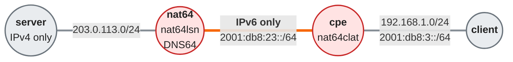

An ISP running out of IPv4 addresses can stop giving them to its
subscribers: the access network carries IPv6 only, and the IPv4 internet
stays reachable through translation:

- the ISP's router runs a stateful NAT64 (`ipfw nat64lsn`): IPv6
  subscribers reach IPv4 servers through a small shared pool of IPv4
  addresses;
- a DNS64 resolver gives IPv4-only names an IPv6 address inside the NAT64
  prefix, so IPv6 applications need nothing else;
- the subscriber's CPE runs a CLAT (`ipfw nat64clat`): the IPv4 packets of
  its LAN leave as IPv6 and the NAT64 turns them back into IPv4. This is
  464XLAT (RFC 6877), for IPv4-only applications and IPv4 literals that
  DNS64 cannot help.

Both translators are FreeBSD's in-kernel `ipfw_nat64` module.

## Overview

### Network diagram



| Router | Role |
|--------|------|
| server | An IPv4-only server on the internet, with `iperf3` |
| nat64 | The ISP: stateful NAT64 to the 198.51.100.0/28 pool, DNS64 |
| cpe | The subscriber's router: IPv6-only uplink, CLAT for its IPv4 LAN |
| client | A dual-stack host on the subscriber's LAN |

The addresses used for translation:

| Prefix | Use |
|--------|-----|
| 2001:db8:64::/96 | NAT64 prefix: 2001:db8:64::cb00:710a is 203.0.113.10 |
| 198.51.100.0/28 | NAT64 pool, the IPv4 sources the server sees |
| 2001:db8:3::/48 | The subscriber's delegated prefix, routed to the CPE |
| 2001:db8:3:464::/96 | CLAT prefix, inside the subscriber's /48 |

The lab uses its own NAT64 prefix rather than the well-known 64:ff9b::/96:
with the well-known prefix, `ipfw_nat64` refuses to translate to private
and documentation IPv4 addresses (RFC 6052), such as this lab's server.
An ISP is free to use a prefix of its own (a network-specific prefix).

## Setting up the lab

### Downloading BSD Router Project images

Download the BSDRP serial image from SourceForge.

### Download lab scripts

More information on these BSDRP lab scripts is available on
[How to build a BSDRP router lab](how-to-build-a-bsdrp-router-lab.md).

Start the lab with four routers, configured automatically by `labconfig`:

```
tools/BSDRP-lab-bhyve.sh -i BSDRP-full-amd64.img -n 4 -r ipv6only
```

The VMs are fully meshed; this lab only uses the links drawn above.

## Router configuration

Each block below is what `labconfig ipv6only_vm<N>` applies. Replace `em`
by `vtnet` in the interface names on bhyve (`labconfig` does it for you).

### Server (VM1)

```
sysrc hostname=server \
 gateway_enable=NO \
 ipv6_gateway_enable=NO \
 ifconfig_em0="inet 203.0.113.10/24" \
 defaultrouter=203.0.113.1
iperf3 -s -D
```

### NAT64 and DNS64 (VM2)

```
sysrc hostname=nat64 \
 ifconfig_em0="inet 203.0.113.1/24" \
 ifconfig_em1_ipv6="inet6 2001:db8:23::1 prefixlen 64" \
 ipv6_static_routes="cpe" \
 ipv6_route_cpe="2001:db8:3:: -prefixlen 48 2001:db8:23::3" \
 firewall_enable=YES \
 firewall_nat64_enable=YES \
 firewall_script="/etc/ipfw.rules" \
 dnsmasq_enable=YES
```

`firewall_nat64_enable` loads `ipfw_nat64`. The first rule sends the
subscribers' IPv6 packets to the NAT64 prefix through the translator; the
second sends back the IPv4 replies to the pool. The pool needs no route
on this router: `ipfw` takes the packets on input, before any route
lookup.

```
cat > /etc/ipfw.rules <<'EOF'
#!/bin/sh
fwcmd="/sbin/ipfw"
${fwcmd} -f flush
${fwcmd} -q nat64lsn isp destroy 2>/dev/null
${fwcmd} nat64lsn isp create prefix4 198.51.100.0/28 prefix6 2001:db8:64::/96
${fwcmd} add 100 nat64lsn isp ip6 from any to 2001:db8:64::/96 in
${fwcmd} add 200 nat64lsn isp ip4 from any to 198.51.100.0/28 in
${fwcmd} add 65000 allow ip from any to any
EOF
```

A DNS64 resolver synthesizes an AAAA record from the A record of any
IPv4-only name. BSDRP ships no resolver that can: `dnsmasq` gives the
lab's only server a static AAAA record in the NAT64 prefix instead,
which is enough to show what the client sees.

```
cat > /usr/local/etc/dnsmasq.conf <<EOF
no-resolv
no-hosts
bind-interfaces
listen-address=::1,2001:db8:23::1
host-record=server.example.net,203.0.113.10,2001:db8:64::cb00:710a
EOF
```

### CPE with CLAT (VM3)

The CPE has no IPv4 address on its uplink and no IPv4 default route.

```
sysrc hostname=cpe \
 ifconfig_em1_ipv6="inet6 2001:db8:23::3 prefixlen 64" \
 ipv6_defaultrouter=2001:db8:23::1 \
 ifconfig_em2="inet 192.168.1.1/24" \
 ifconfig_em2_ipv6="inet6 2001:db8:3::1 prefixlen 64" \
 firewall_enable=YES \
 firewall_nat64_enable=YES \
 firewall_script="/etc/ipfw.rules"
```

The first rule translates the LAN's IPv4 packets to the internet into
IPv6: source in the CLAT prefix, destination in the ISP's NAT64 prefix.
The second translates the replies back into IPv4.

```
cat > /etc/ipfw.rules <<'EOF'
#!/bin/sh
fwcmd="/sbin/ipfw"
${fwcmd} -f flush
${fwcmd} -q nat64clat clat destroy 2>/dev/null
${fwcmd} nat64clat clat create clat_prefix 2001:db8:3:464::/96 plat_prefix 2001:db8:64::/96
${fwcmd} add 100 nat64clat clat ip4 from 192.168.1.0/24 to not 192.168.1.0/24 in
${fwcmd} add 200 nat64clat clat ip6 from 2001:db8:64::/96 to 2001:db8:3:464::/96 in
${fwcmd} add 65000 allow ip from any to any
EOF
```

### Client (VM4)

An ordinary dual-stack host, whose resolver is the ISP's DNS64:

```
sysrc hostname=client \
 gateway_enable=NO \
 ipv6_gateway_enable=NO \
 ifconfig_em2="inet 192.168.1.10/24" \
 ifconfig_em2_ipv6="inet6 2001:db8:3::10 prefixlen 64" \
 defaultrouter=192.168.1.1 \
 ipv6_defaultrouter=2001:db8:3::1
echo "nameserver 2001:db8:23::1" > /etc/resolv.conf
```

## Testing

### NAT64 with DNS64

The client resolves the IPv4-only server into the NAT64 prefix and
reaches it over IPv6:

```
[root@client]~# host -t AAAA server.example.net
server.example.net has IPv6 address 2001:db8:64::cb00:710a
[root@client]~# ping -6 -c 2 server.example.net
PING(56=40+8+8 bytes) 2001:db8:3::10 --> 2001:db8:64::cb00:710a
16 bytes from 2001:db8:64::cb00:710a, icmp_seq=0 hlim=62 time=0.316 ms
16 bytes from 2001:db8:64::cb00:710a, icmp_seq=1 hlim=62 time=0.801 ms
```

### 464XLAT

The same client reaches the server's IPv4 address, although no IPv4
packet crosses the access network:

```
[root@client]~# ping -4 -c 2 203.0.113.10
PING 203.0.113.10 (203.0.113.10): 56 data bytes
64 bytes from 203.0.113.10: icmp_seq=0 ttl=62 time=0.385 ms
64 bytes from 203.0.113.10: icmp_seq=1 ttl=62 time=0.765 ms
```

### NAT64 states

The NAT64 keeps one state per connection. The client's own IPv6 address
and its CLAT address are two different hosts for it, each with its own
address from the pool:

```
[root@nat64]~# ipfw nat64lsn isp show states
2001:db8:3::10  198.51.100.0    ICMPv6          12      203.0.113.10
2001:db8:3::10:63918    198.51.100.0:1024       TCP     SEF     34      203.0.113.10:5201
2001:db8:3:464::c0a8:10a:11212  198.51.100.1:1030       TCP     SEF     1       203.0.113.10:5201
2001:db8:3:464::c0a8:10a:61999  198.51.100.1:1024       UDP             23      203.0.113.10:5201
```

### MTU and fragments

An IPv6 header is 20 bytes longer than an IPv4 one: a full-size 1500-byte
IPv4 packet from the LAN does not fit the 1500-byte IPv6 access once
translated.

- **TCP** sets the DF flag: the CLAT answers "fragmentation needed" with
  an MTU of 1472, and path MTU discovery adapts. The client's TCP host
  cache shows it after an `iperf3 -4` to the server:

```
[root@client]~# sysctl net.inet.tcp.hostcache.list | grep 203.0.113.10
203.0.113.10     1472        0      0ms      0ms        0        0        0 3600
```

- **UDP** without DF is fragmented in IPv6, and the fragments are
  translated into IPv4 fragments that the server reassembles:

```
[root@client]~# iperf3 -4 -c 203.0.113.10 -u -l 1472 -b 1M -t 2
[  4]   0.00-2.02   sec   246 KBytes   999 Kbits/sec  0.033 ms  0/171 (0%)  receiver
```

!!! note "Fragments on a stock FreeBSD kernel"
    On a stock FreeBSD kernel, every IPv6 packet fragmented before the
    translator is lost once in IPv4: its fragments get different IPv4
    IDs, and the next fragments have payload bytes rewritten as if they
    held the UDP header. BSDRP's kernel fixes both, so the UDP test
    above loses nothing. Fragmented ICMP is not translated at all, as
    `ipfw_nat64` documents: a `ping -s 1472` through the CLAT gets no
    answer.

### Automated test

`tools/regression-test.sh <image> ipv6only` runs the checks above: the
translators and DNS64 on each router, the IPv6-only uplink of the CPE,
pings through NAT64 and 464XLAT, TCP transfers both ways, fragmented UDP
both ways with no loss, and the NAT64 states of both client addresses.
