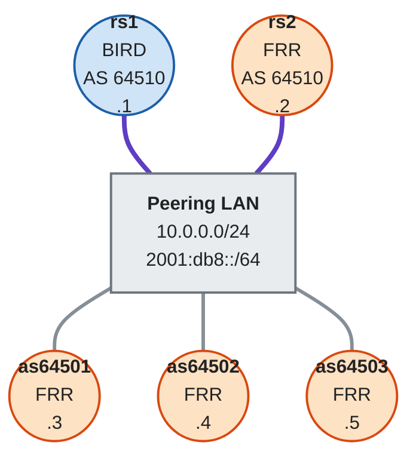

On an Internet Exchange Point (IXP), every member could open a BGP session
with every other member: with N members, that is N x (N-1) / 2 sessions,
each to negotiate and maintain. Route servers (RFC 7947) replace that mesh:
each member peers only with the route servers, which pass every member's
routes on to the others.

A route server is not a router:

- it is transparent: it adds no AS to the path and keeps the original
  next-hop, so traffic goes straight from member to member across the
  peering LAN, never through the route server;
- it filters each member to the prefixes that member registered (usually
  built from IRR or RPKI data), so a typo or a hijack stays local;
- it honours action communities, here `0:<peer AS>` "do not announce to
  this peer" and `0:<route server AS>` "do not announce to anyone";
- IXPs run two of them, often with different software, so that one bug
  or one outage does not take down the exchange.

This lab runs two route servers, rs1 with BIRD and rs2 with FRR, on one
peering LAN with three member networks.

## Overview

### Network diagram



Each member has eBGP sessions with both route servers, over IPv4 for IPv4
routes and over IPv6 for IPv6 routes, and none with the other members.
Each member numbers its `lo1` from its own prefix (.1 and ::1), to test
member-to-member traffic.

| Router | Role |
|--------|------|
| rs1 | BIRD route server, no kernel routes: it forwards nothing |
| rs2 | FRR route server, same policy as rs1 |
| as64501 | Announces 198.51.100.0/24 and 2001:db8:a::/48 |
| as64502 | Announces 203.0.113.0/24 and 2001:db8:b::/48, and hijacks 198.51.100.128/25 and 2001:db8:a:8000::/49 |
| as64503 | Announces 192.0.2.0/24 and 2001:db8:c::/48 tagged `0:64502`: not to AS 64502 |

## Setting up the lab

### Downloading BSD Router Project images

Download the BSDRP serial image from SourceForge.

### Download lab scripts

More information on these BSDRP lab scripts is available on
[How to build a BSDRP router lab](how-to-build-a-bsdrp-router-lab.md).

Start the lab with five routers and one shared LAN, configured
automatically by `labconfig`:

```
tools/BSDRP-lab-bhyve.sh -i BSDRP-full-amd64.img -n 5 -l 1 -r ixp
```

The VMs are also fully meshed; this lab only uses the shared LAN, which
is `em4` (`vtnet4` on bhyve).

## Router configuration

Each block below is what `labconfig ixp_vm<N>` applies, shown for the
first member only where the others follow the same pattern. Replace `em`
by `vtnet` in the interface names on bhyve (`labconfig` does it for you).

### rs1, BIRD (VM1)

```
sysrc hostname=rs1 \
 gateway_enable=NO \
 ipv6_gateway_enable=NO \
 ifconfig_em4="inet 10.0.0.1/24" \
 ifconfig_em4_ipv6="inet6 2001:db8::1 prefixlen 64" \
 bird_enable=YES
```

`/usr/local/etc/bird.conf` has no `kernel` protocol: the route server
never installs the routes it relays. `rs client` keeps the AS path and the
next-hop as received. Each member gets one import filter per address
family: only its registered prefix, its own AS first in the path and its
own address as next-hop. `import keep filtered on` keeps the rejected
routes visible with `birdc show route filtered`.

```
log syslog all;
router id 10.0.0.1;
define RS_AS = 64510;

protocol device {
}

# Action communities set by members: (0, peer AS) "do not announce to this
# peer", (0, RS_AS) "do not announce to anyone".
function rs_export(int peer_as) -> bool {
        if (0, peer_as) ~ bgp_community then return false;
        if (0, RS_AS) ~ bgp_community then return false;
        return true;
}

template bgp rs_member {
        local as RS_AS;
        rs client;
}

protocol bgp as64501_v4 from rs_member {
        neighbor 10.0.0.3 as 64501;
        ipv4 {
                import keep filtered on;
                import filter {
                        if ! (net ~ [ 198.51.100.0/24 ]) then reject;
                        if bgp_path.first != 64501 then reject;
                        if bgp_next_hop != 10.0.0.3 then reject;
                        accept;
                };
                export where rs_export(64501);
        };
}

protocol bgp as64501_v6 from rs_member {
        neighbor 2001:db8::3 as 64501;
        ipv6 {
                import keep filtered on;
                import filter {
                        if ! (net ~ [ 2001:db8:a::/48 ]) then reject;
                        if bgp_path.first != 64501 then reject;
                        if bgp_next_hop != 2001:db8::3 then reject;
                        accept;
                };
                export where rs_export(64501);
        };
}

# Same two blocks for as64502 (10.0.0.4, 203.0.113.0/24, 2001:db8:b::/48)
# and as64503 (10.0.0.5, 192.0.2.0/24, 2001:db8:c::/48)
```

### rs2, FRR (VM2)

```
sysrc hostname=rs2 \
 gateway_enable=NO \
 ipv6_gateway_enable=NO \
 ifconfig_em4="inet 10.0.0.2/24" \
 ifconfig_em4_ipv6="inet6 2001:db8::2 prefixlen 64" \
 frr_enable=YES \
 frr_daemons="mgmtd zebra bgpd"
```

The same policy in FRR: `route-server-client` keeps the AS path and the
next-hop, one inbound route-map per member and address family checks the
prefix, the next-hop and the first AS, and one outbound route-map per
member drops the routes tagged for it. `soft-reconfiguration inbound`
keeps the rejected routes for `show bgp neighbors ... filtered-routes`.

```
frr defaults traditional
hostname rs2
log syslog
!
bgp community-list standard NOT-TO-ANY seq 5 permit 0:64510
!
ip prefix-list AS64501-4 seq 5 permit 198.51.100.0/24
ipv6 prefix-list AS64501-6 seq 5 permit 2001:db8:a::/48
bgp as-path access-list AS64501 seq 5 permit ^64501(_|$)
bgp community-list standard NOT-TO-64501 seq 5 permit 0:64501
route-map AS64501-IN4 permit 10
 match ip address prefix-list AS64501-4
 match ip next-hop address 10.0.0.3
 match as-path AS64501
exit
route-map AS64501-IN6 permit 10
 match ipv6 address prefix-list AS64501-6
 match ipv6 next-hop address 2001:db8::3
 match as-path AS64501
exit
route-map AS64501-OUT deny 10
 match community NOT-TO-64501
exit
route-map AS64501-OUT deny 20
 match community NOT-TO-ANY
exit
route-map AS64501-OUT permit 100
exit
!
! Same for AS64502 and AS64503
!
router bgp 64510
 bgp router-id 10.0.0.2
 neighbor 10.0.0.3 remote-as 64501
 neighbor 2001:db8::3 remote-as 64501
 neighbor 10.0.0.4 remote-as 64502
 neighbor 2001:db8::4 remote-as 64502
 neighbor 10.0.0.5 remote-as 64503
 neighbor 2001:db8::5 remote-as 64503
 address-family ipv4 unicast
  no neighbor 2001:db8::3 activate
  neighbor 10.0.0.3 route-server-client
  neighbor 10.0.0.3 soft-reconfiguration inbound
  neighbor 10.0.0.3 route-map AS64501-IN4 in
  neighbor 10.0.0.3 route-map AS64501-OUT out
  ! Same for 10.0.0.4 and 10.0.0.5
 exit-address-family
 address-family ipv6 unicast
  neighbor 2001:db8::3 activate
  neighbor 2001:db8::3 route-server-client
  neighbor 2001:db8::3 soft-reconfiguration inbound
  neighbor 2001:db8::3 route-map AS64501-IN6 in
  neighbor 2001:db8::3 route-map AS64501-OUT out
  ! Same for 2001:db8::4 and 2001:db8::5
 exit-address-family
exit
```

### Members (VM3 to VM5)

All three members share one configuration, shown here for as64502, which
also announces the hijack. A discard route gives BGP each aggregate to
announce.

```
sysrc hostname=as64502 \
 ifconfig_em4="inet 10.0.0.4/24" \
 ifconfig_em4_ipv6="inet6 2001:db8::4 prefixlen 64" \
 cloned_interfaces="lo1" \
 ifconfig_lo1="inet 203.0.113.1/32" \
 ifconfig_lo1_ipv6="inet6 2001:db8:b::1 prefixlen 128" \
 frr_enable=YES \
 frr_daemons="mgmtd zebra staticd bgpd"
```

The route servers do not put their AS first in the path, and FRR rejects
such updates by default: `no neighbor ... enforce-first-as` is required
on the sessions with them.

```
frr defaults traditional
hostname as64502
log syslog
!
ip route 203.0.113.0/24 blackhole
ipv6 route 2001:db8:b::/48 blackhole
ip route 198.51.100.128/25 blackhole
ipv6 route 2001:db8:a:8000::/49 blackhole
!
router bgp 64502
 bgp router-id 10.0.0.4
 no bgp ebgp-requires-policy
 neighbor RS4 peer-group
 neighbor RS4 remote-as 64510
 no neighbor RS4 enforce-first-as
 neighbor RS6 peer-group
 neighbor RS6 remote-as 64510
 no neighbor RS6 enforce-first-as
 neighbor 10.0.0.1 peer-group RS4
 neighbor 10.0.0.2 peer-group RS4
 neighbor 2001:db8::1 peer-group RS6
 neighbor 2001:db8::2 peer-group RS6
 !
 address-family ipv4 unicast
  network 203.0.113.0/24
  network 198.51.100.128/25
  no neighbor RS6 activate
 exit-address-family
 !
 address-family ipv6 unicast
  network 2001:db8:b::/48
  network 2001:db8:a:8000::/49
  neighbor RS6 activate
 exit-address-family
exit
```

as64503 tags its routes for the route servers:

```
route-map NOT-TO-64502 permit 10
 set community 0:64502
exit
!
router bgp 64503
 ...
 address-family ipv4 unicast
  network 192.0.2.0/24 route-map NOT-TO-64502
 ...
 address-family ipv6 unicast
  network 2001:db8:c::/48 route-map NOT-TO-64502
```

The members here have no outbound filter, so they also announce back to
the route servers what they learned from them: a route leak, which the
route servers drop too (wrong prefix, wrong first AS).

## Testing

### BGP sessions

Each route server has six sessions, two per member:

```
[root@rs1]~# birdc show protocols
BIRD 3.4.0 ready.
Name       Proto      Table      State  Since         Info
device1    Device     ---        up     21:36:39.794
as64501_v4 BGP        ---        up     21:36:44.433  Established
as64501_v6 BGP        ---        up     21:36:44.358  Established
as64502_v4 BGP        ---        up     21:36:44.516  Established
as64502_v6 BGP        ---        up     21:36:43.688  Established
as64503_v4 BGP        ---        up     21:36:43.853  Established
as64503_v6 BGP        ---        up     21:36:43.798  Established
```

### A transparent route server

as64503 learns as64501's prefix from both route servers. The AS path is
only `64501`, without 64510, and the next-hop is as64501 itself:

```
[root@as64503]~# vtysh -c "show bgp ipv4 unicast 198.51.100.0/24"
BGP routing table entry for 198.51.100.0/24, version 20
Paths: (2 available, best #1, table default)
  Advertised to peers:
  10.0.0.1 10.0.0.2
  64501
    10.0.0.3 from 10.0.0.1 (10.0.0.1)
      Origin IGP, metric 0, valid, external, multipath, best (Older Path)
  64501
    10.0.0.3 from 10.0.0.2 (10.0.0.2)
      Origin IGP, metric 0, valid, external, multipath
```

The traffic crosses the peering LAN in a single hop:

```
[root@as64503]~# traceroute -n -s 192.0.2.1 198.51.100.1
traceroute to 198.51.100.1 (198.51.100.1) from 192.0.2.1, 64 hops max, 40 byte packets
 1  198.51.100.1  0.385 ms  0.270 ms  0.421 ms
```

For IPv6, BIRD passes on the member's link-local next-hop together with
the global one, FRR only the global one: the members list both, as two
next-hops to the same router.

### Filtering a hijack

as64502 announces 198.51.100.128/25, a more specific of as64501's prefix.
Both route servers reject it, with as64502's leak of 198.51.100.0/24:

```
[root@rs1]~# birdc show route filtered protocol as64502_v4
BIRD 3.4.0 ready.
Table master4:
198.51.100.0/24      unicast [as64502_v4 21:36:49.158] (100) [AS64501i]
        via 10.0.0.4 on vtnet4
198.51.100.128/25    unicast [as64502_v4 21:36:45.768] * (100) [AS64502i]
        via 10.0.0.4 on vtnet4
[root@rs2]~# vtysh -c "show bgp ipv4 unicast neighbors 10.0.0.4 filtered-routes"
...
     Network          Next Hop            Metric LocPrf Weight Path
 *> 198.51.100.0/24  10.0.0.3                               0 64502 64501 i
 *> 198.51.100.128/25
                    10.0.0.4                 0             0 64502 i
```

The other members still send the hijacked range to as64501:

```
[root@as64503]~# route -n get 198.51.100.200
   route to: 198.51.100.200
destination: 198.51.100.0
       mask: 255.255.255.0
    gateway: 10.0.0.3
```

Without the filters, the /25 would win as the longest match, and
as64503's traffic to half of as64501's addresses would end up in
as64502's discard route.

### Action community

as64503 tagged its routes `0:64502`: as64501 receives them, as64502 does
not:

```
[root@as64502]~# vtysh -c "show bgp ipv4 unicast"
...
     Network          Next Hop            Metric LocPrf Weight Path
 *>  198.51.100.0/24  10.0.0.3                 0             0 64501 i
 *=                   10.0.0.3                 0             0 64501 i
 *>  198.51.100.128/25
                    0.0.0.0                  0         32768 i
 *>  203.0.113.0/24   0.0.0.0                  0         32768 i
```

### Losing a route server

Stop BIRD on rs1 while as64503 pings as64501: the members keep the routes
from rs2, and since the next-hop does not change, no packet is lost:

```
[root@as64503]~# ping -i 0.2 -c 100 -S 192.0.2.1 198.51.100.1 &
[root@rs1]~# service bird stop
[root@as64503]~# vtysh -c "show bgp ipv4 unicast 198.51.100.0/24" | grep Paths
Paths: (1 available, best #1, table default)
...
100 packets transmitted, 100 packets received, 0.0% packet loss
```

The same holds when FRR stops on rs2.

### Automated test

`tools/regression-test.sh <image> ixp` runs the checks above: the
sessions on both route servers, the hijack filtered by each, the AS path,
next-hop and pings between members over IPv4 and IPv6, the action
community, and the loss of each route server in turn.
