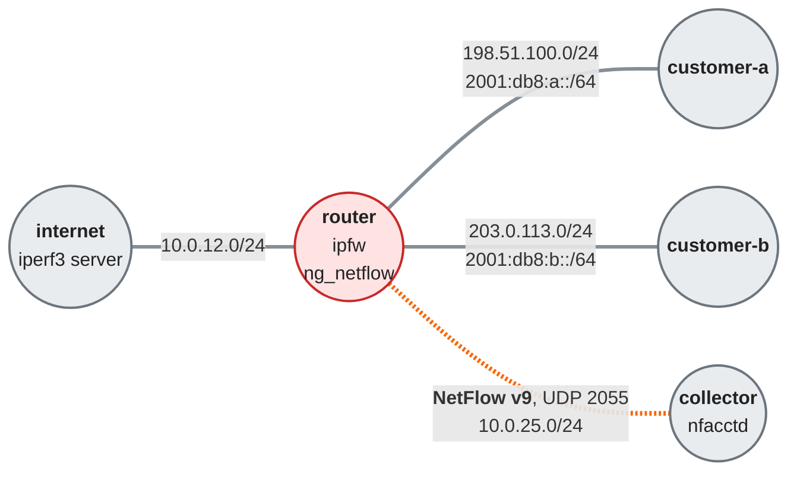

An ISP has to know how much traffic each customer sends and receives: to
bill by volume, to enforce a fair-use cap, or to report on usage. The
router already sees every packet, but it should not store or total
anything itself. It exports NetFlow, a summary of each flow, and a
collector does the accounting:

- the BSDRP router exports NetFlow v9 with FreeBSD's `ng_netflow`, fed by
  an `ipfw` rule (the `ipfw_netflow` rc script);
- the collector runs `nfacctd` from pmacct, which tags each flow with the
  customer and the direction from a map of the customers' address space,
  and totals bytes and packets per tag;
- the totals are available live (`pmacct -s`) and as one CSV file per
  minute, ready for a billing system.

IPv4 and IPv6 are accounted the same way.

## Overview

### Network diagram



The internet link also has an IPv6 twin, 2001:db8:12::/64. customer-a
owns 198.51.100.0/24 and 2001:db8:a::/48, customer-b 203.0.113.0/24 and
2001:db8:b::/48; each customer VM has the .10 (::10) address on its access
link.

| Router | Role |
|--------|------|
| internet | The rest of the world, with an `iperf3` server to download from |
| router | Routes the customers, exports NetFlow v9 to the collector |
| customer-a, customer-b | Customers downloading and uploading known volumes |
| collector | `nfacctd`: per-customer totals, live and in CSV files |

## Setting up the lab

### Downloading BSD Router Project images

Download the BSDRP serial image from SourceForge.

### Download lab scripts

More information on these BSDRP lab scripts is available on
[How to build a BSDRP router lab](how-to-build-a-bsdrp-router-lab.md).

Start the lab with five routers, configured automatically by `labconfig`:

```
tools/BSDRP-lab-bhyve.sh -i BSDRP-full-amd64.img -n 5 -r accounting
```

The VMs are fully meshed; this lab only uses the links drawn above.

## Router configuration

Each block below is what `labconfig accounting_vm<N>` applies. Replace
`em` by `vtnet` in the interface names on bhyve (`labconfig` does it for
you).

### Internet (VM1)

```
sysrc hostname=internet \
 gateway_enable=NO \
 ipv6_gateway_enable=NO \
 ifconfig_em0="inet 10.0.12.1/24" \
 ifconfig_em0_ipv6="inet6 2001:db8:12::1 prefixlen 64" \
 defaultrouter=10.0.12.2 \
 ipv6_defaultrouter=2001:db8:12::2
iperf3 -s -D
```

### Router (VM2)

```
sysrc hostname=router \
 ifconfig_em0="inet 10.0.12.2/24" \
 ifconfig_em0_ipv6="inet6 2001:db8:12::2 prefixlen 64" \
 ifconfig_em1="inet 198.51.100.1/24" \
 ifconfig_em1_ipv6="inet6 2001:db8:a::1 prefixlen 64" \
 ifconfig_em2="inet 203.0.113.1/24" \
 ifconfig_em2_ipv6="inet6 2001:db8:b::1 prefixlen 64" \
 ifconfig_em3="inet 10.0.25.2/24" \
 firewall_enable=YES \
 firewall_script="/etc/ipfw.rules" \
 ipfw_netflow_enable=YES \
 ipfw_netflow_ip=10.0.25.5 \
 ipfw_netflow_port=2055 \
 ipfw_netflow_version=9
```

The `ipfw_netflow` rc script creates the `ng_netflow` node and adds rule
1000, `ngtee 9995 ip from any to any`, which copies every packet to it. A
forwarded packet crosses `ipfw` twice, once in and once out: without the
`skipto` rule below, every byte would be accounted twice.

```
cat > /etc/ipfw.rules <<'EOF'
#!/bin/sh
fwcmd="/sbin/ipfw"
${fwcmd} -f flush
${fwcmd} add 900 skipto 1100 ip from any to any out
${fwcmd} add 65000 allow ip from any to any
EOF
```

`ng_netflow` defaults suit a busy router more than a lab one. A small rc
script, `/usr/local/etc/rc.d/netflow_tune` with `netflow_tune_enable=YES`,
tunes the node at every boot once `ipfw_netflow` has created it:

```
#!/bin/sh
# PROVIDE: netflow_tune
# REQUIRE: ipfw_netflow

. /etc/rc.subr

name="netflow_tune"
rcvar="${name}_enable"
start_cmd="${name}_start"
stop_cmd=":"

netflow_tune_start()
{
	ngctl msg netflow: settimeouts '{ inactive=5 active=60 }'
	ngctl msg netflow: settemplate '{ time=60 packets=20 }'
}

load_rc_config $name
run_rc_command "$1"
```

- `settimeouts`: a flow is exported 5 s after its last packet, and a long
  one every 60 s, instead of 15 s and 30 minutes.
- `settemplate`: the NetFlow v9 template, without which the collector
  cannot decode anything, goes out with the first export instead of after
  10 minutes of uptime.

!!! note "Export delay on a quiet router"
    FreeBSD's `ng_netflow` sends an export datagram only once it is full.
    On a busy router a 1500-byte datagram fills in a blink; on a quiet one,
    expired flows could wait for minutes. BSDRP's kernel also sends a partly
    filled datagram every second. On a stock FreeBSD kernel,
    `ngctl msg netflow: setmtu '{ mtu=200 }'` gets the same result for
    NetFlow v9, with one record per datagram.

### Customers (VM3 and VM4)

customer-a; customer-b is the same with 203.0.113 and 2001:db8:b::

```
sysrc hostname=customer-a \
 gateway_enable=NO \
 ipv6_gateway_enable=NO \
 ifconfig_em1="inet 198.51.100.10/24" \
 ifconfig_em1_ipv6="inet6 2001:db8:a::10 prefixlen 64" \
 defaultrouter=198.51.100.1 \
 ipv6_defaultrouter=2001:db8:a::1
```

### Collector (VM5)

```
sysrc hostname=collector \
 gateway_enable=NO \
 ipv6_gateway_enable=NO \
 ifconfig_em1="inet 10.0.25.5/24" \
 nfacctd_enable=YES
```

The customers' address space, in `/usr/local/etc/customers.map`: traffic
to it is "in", traffic from it "out", and the first matching line wins.
The tag is the customer number x 100, plus 1 for in and 2 for out (the
memory plugin cannot aggregate on text labels):

```
set_tag=101 dst_net=198.51.100.0/24
set_tag=101 dst_net=2001:db8:a::/48
set_tag=102 src_net=198.51.100.0/24
set_tag=102 src_net=2001:db8:a::/48
set_tag=201 dst_net=203.0.113.0/24
set_tag=201 dst_net=2001:db8:b::/48
set_tag=202 src_net=203.0.113.0/24
set_tag=202 src_net=2001:db8:b::/48
```

`/usr/local/etc/nfacctd.conf` runs two plugins on the same tagged flows:
`live`, an in-memory table for `pmacct -s`, and `billing`, which writes one
CSV file per minute. `nfacctd_time_new` puts each flow in the minute it
reached the collector: with the exporter's own flow timestamps, the flows
of a bulk transfer never reached a CSV file in this lab.

```
daemonize: true
syslog: daemon
nfacctd_time_new: true
nfacctd_ip: 10.0.25.5
nfacctd_port: 2055
pre_tag_map: /usr/local/etc/customers.map
plugins: memory[live], print[billing]
aggregate[live]: tag
aggregate[billing]: tag
imt_path[live]: /tmp/accounting.pipe
print_output[billing]: csv
print_output_file[billing]: /var/log/accounting-%Y%m%d-%H%M.csv
print_refresh_time[billing]: 60
print_history[billing]: 1m
print_history_roundoff[billing]: m
print_output_file_append[billing]: true
```

## Testing

### Known transfers

Reset the live table (`-e` prints it, then erases it), then transfer known
volumes: customer-a downloads 40 MiB over IPv4 and uploads 10 MiB over
IPv6, customer-b downloads 20 MiB over IPv6:

```
[root@collector]~# pmacct -s -p /tmp/accounting.pipe -e
[root@customer-a]~# iperf3 -c 10.0.12.1 -R -n 40M
[root@customer-a]~# iperf3 -6 -c 2001:db8:12::1 -n 10M
[root@customer-b]~# iperf3 -6 -c 2001:db8:12::1 -R -n 20M
```

### Live totals

A few seconds after the transfers:

```
[root@collector]~# pmacct -s -p /tmp/accounting.pipe
TAG         PACKETS               BYTES
201         14709                 22030900
101         32857                 43754355
202         7512                  544115
102         22173                 11793465

For a total of: 4 entries
```

| Tag | Customer, direction | Transferred | Accounted | Ratio |
|-----|---------------------|-------------|-----------|-------|
| 101 | customer-a, in | 40 MiB (IPv4) | 43.75 MB | 1.04 |
| 102 | customer-a, out | 10 MiB (IPv6) | 11.79 MB | 1.12 |
| 201 | customer-b, in | 20 MiB (IPv6) | 22.03 MB | 1.05 |
| 202 | customer-b, out | (ACKs only) | 0.54 MB | |

NetFlow counts IP bytes, so the totals are a little above the payload:
the TCP/IP headers (larger in IPv6), and in each direction the ACKs of the
transfers going the other way. Counting each forwarded packet twice would
give a ratio of 2.

### Billing files

The same flows land in the per-minute CSV files, a minute or two after
the minute ends. Here customer-b's 20 MiB download, alone in its minute:

```
[root@collector]~# cat /var/log/accounting-20261118-2246.csv
TAG,PACKETS,BYTES
201,14705,22033486
202,7451,538472
```

Tag 0, in other files, is traffic that matches no customer, such as
packets to the router itself. `/var` is a tmpfs on BSDRP: a real collector writes these
files to persistent storage, or uses one of pmacct's SQL, Kafka or other
plugins instead of `print`.

### Automated test

`tools/regression-test.sh <image> accounting` runs the checks above: the
`ipfw` and `ng_netflow` setup on the router, the collector's live table,
then the three transfers, and requires each customer's total to be within
100% and 120% of the transferred volume, and customer-a's download in the
CSV files.
