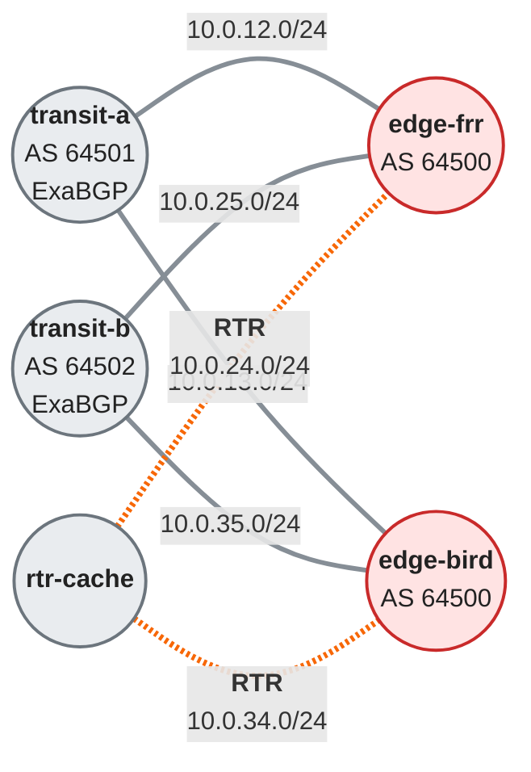

A BGP router believes any route its neighbors send. If a network
announces somebody else's prefix, or a more specific part of it, the
traffic goes to that network: a hijack, by mistake or on purpose. RPKI
route origin validation (RFC 6811) lets a router check the origin of a
route:

- each address holder publishes ROAs (Route Origin Authorizations) in
  the RPKI: "this prefix, up to this length, may be originated by this
  AS";
- a validator, also called an RPKI cache, downloads and checks them, and
  serves the result to the routers over the RPKI-to-Router (RTR)
  protocol (RFC 8210);
- each route then is **valid** (a ROA matches it), **invalid** (a ROA
  covers the prefix but not this origin AS, or not this length), or
  **not found** (no ROA covers it). Routers drop the invalid routes.

This lab runs both route origin validation implementations BSDRP ships:
FRR's `rpki` module and BIRD's `rpki` protocol, side by side on the same
routes.

## Overview

### Network diagram



Each BGP link also has an IPv6 twin, 2001:db8:12::/64 etc.

| Router | Role |
|--------|------|
| transit-a | Legitimate transit: announces its customers' routes and answers on their .10 addresses |
| transit-b | Hijacking transit: announces more specific parts of the same routes, and drops their traffic |
| edge-frr | ISP edge router, FRR with the `rpki` module |
| edge-bird | ISP edge router, BIRD with the `rpki` protocol |
| rtr-cache | RPKI cache, serving the ROAs to both edges over RTR |

The routes and ROAs:

| Route | From | Origin | ROA | State |
|-------|------|--------|-----|-------|
| 192.0.2.0/24 | transit-a | 64511 | 192.0.2.0/24-24 AS 64511 | valid |
| 192.0.2.0/25 | transit-b | 64511 | (same) | invalid: too specific |
| 198.51.100.0/24 | transit-a | 64512 | 198.51.100.0/24-24 AS 64512 | valid |
| 198.51.100.0/25 | transit-b | 64666 | (same) | invalid: wrong origin |
| 2001:db8:1::/48 | transit-a | 64511 | 2001:db8:1::/48-48 AS 64511 | valid |
| 2001:db8:1::/49 | transit-b | 64666 | (same) | invalid |
| 203.0.113.0/24 | transit-a | 64513 | none, added later | not found |
| 203.0.113.0/25 | transit-b | 64666 | none, added later | not found |
| 2001:db8:3::/48 | transit-a | 64513 | none, added later | not found |
| 2001:db8:3::/49 | transit-b | 64666 | none, added later | not found |

192.0.2.0/25 shows that the origin AS alone is not enough: the hijacker
forged the right origin, but the ROA's maximum length (24) makes any
more specific route invalid.

!!! warning "The RTR cache of this lab is not a validator"
    A real RPKI cache, such as Routinator or rpki-client with StayRTR,
    downloads the RPKI repositories over rsync and RRDP and checks their
    signatures: it needs internet access, memory and disk, and belongs on
    two or more servers shared by all the routers, not on a router. This
    lab needs neither internet access nor real ROAs: BSDRP's `rtrcache`
    serves the ROAs listed in a text file over RTR (versions 0, 1 and 2),
    without any validation. Use it for labs only.

## Setting up the lab

### Downloading BSD Router Project images

Download the BSDRP serial image from SourceForge.

### Download lab scripts

More information on these BSDRP lab scripts is available on
[How to build a BSDRP router lab](how-to-build-a-bsdrp-router-lab.md).

Start the lab with five routers, configured automatically by `labconfig`:

```
tools/BSDRP-lab-bhyve.sh -i BSDRP-full-amd64.img -n 5 -r rpki
```

The VMs are fully meshed; this lab only uses the links drawn above.

## Router configuration

Each block below is what `labconfig rpki_vm<N>` applies. Replace `em` by
`vtnet` in the interface names on bhyve (`labconfig` does it for you).

### Transits (VM1 and VM5)

transit-a announces its routes with ExaBGP, an IPv4 and an IPv6 session
to each edge. Its configuration towards edge-frr (the sessions to
edge-bird are the same with 10.0.13.0/24):

```
sysrc hostname=transit-a \
 gateway_enable=NO \
 ipv6_gateway_enable=NO \
 ifconfig_em0="inet 10.0.12.1/24" \
 ifconfig_em0_ipv6="inet6 2001:db8:12::1 prefixlen 64" \
 ifconfig_em1="inet 10.0.13.1/24" \
 ifconfig_em1_ipv6="inet6 2001:db8:13::1 prefixlen 64" \
 cloned_interfaces=lo1 \
 ifconfig_lo1="inet 192.0.2.10/32" \
 ifconfig_lo1_alias0="inet 198.51.100.10/32" \
 ifconfig_lo1_alias1="inet 203.0.113.10/32" \
 ifconfig_lo1_ipv6="inet6 2001:db8:1::10 prefixlen 128" \
 ifconfig_lo1_alias2="inet6 2001:db8:3::10 prefixlen 128" \
 exabgp_enable=YES
```

```
neighbor 10.0.12.2 {
	router-id 10.0.0.1;
	local-address 10.0.12.1;
	local-as 64501;
	peer-as 64500;
	family {
		ipv4 unicast;
	}
	static {
		route 192.0.2.0/24 next-hop self as-path [ 64501 64511 ];
		route 198.51.100.0/24 next-hop self as-path [ 64501 64512 ];
		route 203.0.113.0/24 next-hop self as-path [ 64501 64513 ];
	}
}
neighbor 2001:db8:12::2 {
	router-id 10.0.0.1;
	local-address 2001:db8:12::1;
	local-as 64501;
	peer-as 64500;
	family {
		ipv6 unicast;
	}
	static {
		route 2001:db8:1::/48 next-hop self as-path [ 64501 64511 ];
		route 2001:db8:3::/48 next-hop self as-path [ 64501 64513 ];
	}
}
```

transit-b (AS 64502, on 10.0.25.0/24 and 10.0.35.0/24) is the same, with
the /25 and /49 routes of the table above and no `lo1`: it has no route
to these addresses, and drops the traffic its hijacks attract.

### RTR cache (VM4)

```
sysrc hostname=rtr-cache \
 gateway_enable=NO \
 ipv6_gateway_enable=NO \
 ifconfig_em1="inet 10.0.24.4/24" \
 ifconfig_em2="inet 10.0.34.4/24" \
 rtrcache_enable=YES
```

`rtrcache` serves `/usr/local/etc/rtrcache.roas` on TCP port 323, and
re-reads it when it changes:

```
# prefix max-length origin-AS
192.0.2.0/24 24 64511
198.51.100.0/24 24 64512
2001:db8:1::/48 48 64511
```

### edge-frr (VM2)

```
sysrc hostname=edge-frr \
 ifconfig_em0="inet 10.0.12.2/24" \
 ifconfig_em0_ipv6="inet6 2001:db8:12::2 prefixlen 64" \
 ifconfig_em2="inet 10.0.24.2/24" \
 ifconfig_em3="inet 10.0.25.2/24" \
 ifconfig_em3_ipv6="inet6 2001:db8:25::2 prefixlen 64" \
 frr_enable=YES \
 frr_daemons="mgmtd zebra bgpd" \
 bgpd_flags="-A 127.0.0.1 -M rpki"
```

bgpd only loads the `rpki` module when started with `-M rpki`. The route
map drops the invalid routes, and `soft-reconfiguration inbound` keeps
every received route: when the ROAs change, bgpd validates them again
and applies the route map, without resetting the BGP sessions.

```
rpki
 rpki polling_period 60
 rpki retry_interval 10
 rpki cache tcp 10.0.24.4 323 preference 1
exit
!
route-map TRANSIT-IN deny 10
 match rpki invalid
exit
route-map TRANSIT-IN permit 20
exit
!
router bgp 64500
 bgp router-id 10.0.0.2
 neighbor TRANSIT4 peer-group
 neighbor TRANSIT6 peer-group
 neighbor 10.0.12.1 remote-as 64501
 neighbor 10.0.12.1 peer-group TRANSIT4
 neighbor 10.0.25.5 remote-as 64502
 neighbor 10.0.25.5 peer-group TRANSIT4
 neighbor 2001:db8:12::1 remote-as 64501
 neighbor 2001:db8:12::1 peer-group TRANSIT6
 neighbor 2001:db8:25::5 remote-as 64502
 neighbor 2001:db8:25::5 peer-group TRANSIT6
 !
 address-family ipv4 unicast
  neighbor TRANSIT4 soft-reconfiguration inbound
  neighbor TRANSIT4 route-map TRANSIT-IN in
  no neighbor TRANSIT6 activate
 exit-address-family
 !
 address-family ipv6 unicast
  neighbor TRANSIT6 activate
  neighbor TRANSIT6 soft-reconfiguration inbound
  neighbor TRANSIT6 route-map TRANSIT-IN in
 exit-address-family
exit
```

!!! note "Revalidation on a stock FRR"
    On a stock FRR 10.7, a ROA change updates the state that `show bgp`
    displays, but the routes it covers are not run through the route map
    again: a route that a new ROA makes invalid stays the best route
    (`I*>`), until a `clear bgp ... soft in`. BSDRP's FRR package fixes
    the lookup that finds these routes.

### edge-bird (VM3)

```
sysrc hostname=edge-bird \
 ifconfig_em0="inet 10.0.13.3/24" \
 ifconfig_em0_ipv6="inet6 2001:db8:13::3 prefixlen 64" \
 ifconfig_em2="inet 10.0.34.3/24" \
 ifconfig_em3="inet 10.0.35.3/24" \
 ifconfig_em3_ipv6="inet6 2001:db8:35::3 prefixlen 64" \
 bird_enable=YES
```

The `rpki` protocol fills the `r4` and `r6` ROA tables. `import table`
keeps every received route, so BIRD validates them again when the ROA
tables change (`rpki reload`, on by default); `import keep filtered`
lets `show route filtered` list the invalid ones.

```
log syslog all;
router id 10.0.0.3;

protocol device {
}

protocol kernel {
	ipv4 { export all; };
}

protocol kernel {
	ipv6 { export all; };
}

roa4 table r4;
roa6 table r6;

protocol rpki rtr_cache {
	roa4 { table r4; };
	roa6 { table r6; };
	remote 10.0.34.4 port 323;
}

filter rov4 {
	if roa_check(r4) = ROA_INVALID then reject "RPKI invalid";
	accept;
}

filter rov6 {
	if roa_check(r6) = ROA_INVALID then reject "RPKI invalid";
	accept;
}

protocol bgp transit_a_v4 {
	local as 64500;
	neighbor 10.0.13.1 as 64501;
	ipv4 {
		import table on;
		import keep filtered on;
		import filter rov4;
		export none;
	};
}
```

`transit_a_v6`, `transit_b_v4` and `transit_b_v6` follow the same
pattern, with `rov6` for IPv6.

## Testing

### ROAs on the edges

```
[root@edge-frr]~# vtysh -c 'show rpki prefix-table'
RPKI/RTR prefix table
Prefix                                   Prefix Length  Origin-AS
192.0.2.0                                   24 -  24   64511
198.51.100.0                                24 -  24   64512
2001:db8:1::                                48 -  48   64511
Number of IPv4 Prefixes: 2
Number of IPv6 Prefixes: 1
```

```
[root@edge-bird]~# birdc show route table r4
Table r4:
192.0.2.0/24-24 AS64511  [rtr_cache 13:07:32.031] * (100)
198.51.100.0/24-24 AS64512  [rtr_cache 13:07:32.031] * (100)
```

### Invalid routes dropped

FRR shows the state of every route it kept: the invalid ones are gone,
and the hijacks without a ROA are still there.

```
[root@edge-frr]~# vtysh -c 'show bgp ipv4 unicast'
RPKI validation codes: V valid, I invalid, N Not found
     Network          Next Hop            Metric LocPrf Weight Path
V*>  192.0.2.0/24     10.0.12.1                              0 64501 64511 i
V*>  198.51.100.0/24  10.0.12.1                              0 64501 64512 i
N*>  203.0.113.0/24   10.0.12.1                              0 64501 64513 i
N*>  203.0.113.0/25   10.0.25.5                              0 64502 64666 i
```

BIRD lists the routes its filter rejected:

```
[root@edge-bird]~# birdc show route filtered
Table master4:
192.0.2.0/25         unicast [transit_b_v4 13:07:32.658] * (100) [AS64511i]
        via 10.0.35.5 on vtnet3
198.51.100.0/25      unicast [transit_b_v4 13:07:32.699] * (100) [AS64666i]
        via 10.0.35.5 on vtnet3
Table master6:
2001:db8:1::/49      unicast [transit_b_v6 13:07:32.658] * (100) [AS64666i]
        via 2001:db8:35::5 on vtnet3
```

The traffic to the protected prefixes reaches transit-a; the one to
203.0.113.10, not protected, goes to the more specific hijack and is
lost:

```
[root@edge-bird]~# route -n get 198.51.100.10 | grep gateway
    gateway: 10.0.13.1
[root@edge-bird]~# route -n get 203.0.113.10 | grep gateway
    gateway: 10.0.35.5
[root@edge-bird]~# ping -c 2 203.0.113.10
2 packets transmitted, 0 packets received, 100.0% packet loss
```

### A new ROA stops a running hijack

The holder of 203.0.113.0/24 and 2001:db8:3::/48 publishes their ROAs:

```
[root@rtr-cache]~# echo '203.0.113.0/24 24 64513' >> /usr/local/etc/rtrcache.roas
[root@rtr-cache]~# echo '2001:db8:3::/48 48 64513' >> /usr/local/etc/rtrcache.roas
```

The cache increases its serial and sends a Serial Notify; both edges
fetch the difference, and the /25 and /49 hijacks become invalid and are
dropped within a few seconds, without any BGP session reset:

```
[root@edge-frr]~# vtysh -c 'show bgp ipv4 unicast' | grep 203
V*>  203.0.113.0/24   10.0.12.1                              0 64501 64513 i
[root@edge-frr]~# ping -c 2 203.0.113.10
2 packets transmitted, 2 packets received, 0.0% packet loss
```

### Cache outage

When the cache stops, the edges keep the ROAs they have, until the
expire timer the cache gave them (600 s here, 7200 s by default), and
keep dropping the invalid routes. They reconnect when the cache is back.
This is why a network runs at least two caches: a router can use
several, FRR with one `rpki cache` line per cache and BIRD with one
`rpki` protocol per cache.

### Automated test

`tools/regression-test.sh <image> rpki` runs the checks above: the RTR
sessions and the ROAs on both edges, the invalid routes dropped and the
traffic to transit-a, the not-found hijack, the new ROAs stopping it
without a BGP reset, and the cache outage.
