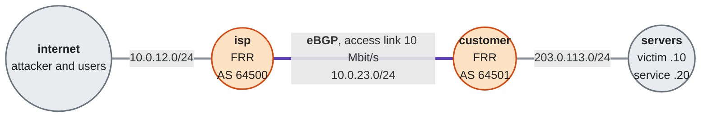

A volumetric DDoS fills the customer's access link: the attacked server is
down, and so is every other service behind the same link. Filtering on the
customer's router is too late, the traffic has already crossed the link.
Remotely triggered blackholing (RTBH, RFC 5635) moves the drop upstream:

- the customer announces the attacked address as a /32 (or /128) tagged
  with the well-known BLACKHOLE community, 65535:666 (RFC 7999);
- the ISP accepts such host routes from its customer, sets their next-hop
  to a discard address and adds NO_EXPORT;
- the flood towards that address is dropped at the ISP edge, and the
  access link is free again for every other service.

The attacked address stays unreachable: RTBH sacrifices one address to
save the rest of the network. The customer triggers it with one static
route, and withdraws it the same way when the attack stops.

## Overview

### Network diagram



Every IPv4 subnet has an IPv6 twin: 10.0.XY.0/24 is 2001:db8:XY::/64, and
the customer owns 203.0.113.0/24 and 2001:db8:113::/48. The ISP limits the
access link to 10 Mbit/s with a dummynet pipe, so a small flood is enough
to fill it.

| Router | Role |
|--------|------|
| internet | The attacker, and a user of the other service |
| isp | FRR, eBGP with the customer, honours BLACKHOLE on the customer's own space |
| customer | FRR, announces its space and triggers the blackhole |
| servers | The victim on .10, another service on .20, an `iperf3` server to flood |

## Setting up the lab

### Downloading BSD Router Project images

Download the BSDRP serial image from SourceForge.

### Download lab scripts

More information on these BSDRP lab scripts is available on
[How to build a BSDRP router lab](how-to-build-a-bsdrp-router-lab.md).

Start the lab with four routers, configured automatically by `labconfig`:

```
tools/BSDRP-lab-bhyve.sh -i BSDRP-full-amd64.img -n 4 -r rtbh
```

The VMs are fully meshed; this lab only uses the links drawn above.

## Router configuration

Each block below is what `labconfig rtbh_vm<N>` applies. Replace `em` by
`vtnet` in the interface names on bhyve (`labconfig` does it for you).

### Internet (VM1)

```
sysrc hostname=internet \
 gateway_enable=NO \
 ipv6_gateway_enable=NO \
 ifconfig_em0="inet 10.0.12.1/24" \
 ifconfig_em0_ipv6="inet6 2001:db8:12::1 prefixlen 64" \
 defaultrouter=10.0.12.2 \
 ipv6_defaultrouter=2001:db8:12::2
config save
service hostname restart
service netif restart
service routing restart
```

### ISP (VM2)

The access link, 10 Mbit/s towards the customer:

```
sysrc hostname=isp \
 ifconfig_em0="inet 10.0.12.2/24" \
 ifconfig_em0_ipv6="inet6 2001:db8:12::2 prefixlen 64" \
 ifconfig_em1="inet 10.0.23.2/24" \
 ifconfig_em1_ipv6="inet6 2001:db8:23::2 prefixlen 64" \
 firewall_enable=YES \
 firewall_script="/etc/ipfw.rules" \
 frr_enable=YES \
 frr_daemons="mgmtd zebra staticd bgpd"
cat > /etc/ipfw.rules <<'EOF'
#!/bin/sh
fwcmd="/sbin/ipfw"
kldstat -q -m dummynet || kldload dummynet
${fwcmd} -f flush
${fwcmd} pipe 1 config bw 10Mbit/s
${fwcmd} add 1000 pipe 1 ip from any to any out xmit em1
${fwcmd} add 65000 allow ip from any to any
EOF
```

The BGP policy. 192.0.2.1 and 100::1 (the RFC 6666 discard prefix) are
static blackhole routes: a route whose next-hop resolves through them is
installed as a blackhole. The customer may announce its aggregate, or any
more specific route of its own space when it carries BLACKHOLE:

```
cat > /usr/local/etc/frr/frr.conf <<EOF
frr defaults traditional
hostname isp
log syslog
!
ip route 192.0.2.1/32 blackhole
ipv6 route 100::1/128 blackhole
!
ip prefix-list CUST4 seq 5 permit 203.0.113.0/24 le 32
ip prefix-list CUST4-AGG seq 5 permit 203.0.113.0/24
ipv6 prefix-list CUST6 seq 5 permit 2001:db8:113::/48 le 128
ipv6 prefix-list CUST6-AGG seq 5 permit 2001:db8:113::/48
bgp community-list standard BLACKHOLE seq 5 permit 65535:666
!
route-map CUST4-IN permit 10
 match ip address prefix-list CUST4
 match community BLACKHOLE
 set ip next-hop 192.0.2.1
 set community no-export additive
exit
route-map CUST4-IN permit 20
 match ip address prefix-list CUST4-AGG
exit
!
route-map CUST6-IN permit 10
 match ipv6 address prefix-list CUST6
 match community BLACKHOLE
 set ipv6 next-hop global 100::1
 set ipv6 next-hop prefer-global
 set community no-export additive
exit
route-map CUST6-IN permit 20
 match ipv6 address prefix-list CUST6-AGG
exit
!
router bgp 64500
 bgp router-id 10.0.0.2
 no bgp ebgp-requires-policy
 neighbor 10.0.23.3 remote-as 64501
 neighbor 10.0.23.3 disable-connected-check
 neighbor 2001:db8:23::3 remote-as 64501
 neighbor 2001:db8:23::3 disable-connected-check
 !
 address-family ipv4 unicast
  neighbor 10.0.23.3 route-map CUST4-IN in
  no neighbor 2001:db8:23::3 activate
 exit-address-family
 !
 address-family ipv6 unicast
  neighbor 2001:db8:23::3 activate
  neighbor 2001:db8:23::3 route-map CUST6-IN in
 exit-address-family
exit
!
EOF
config save
service hostname restart
service netif restart
service routing restart
service ipfw start
service frr start
```

Two FRR details matter here:

- for a directly connected eBGP peer, bgpd only lets zebra use a next-hop
  on the connected subnet. `disable-connected-check` lets the discard
  next-hop resolve through the blackhole route; without it the route stays
  `inactive`.
- an IPv6 eBGP route carries the peer's link-local next-hop too, and FRR
  installs that one by default. `prefer-global` makes it use the discard
  address.

### Customer (VM3)

A static route tagged 666 is the trigger: BGP redistributes it with the
BLACKHOLE community. The untagged /48 discard route only gives BGP the
IPv6 aggregate to announce:

```
sysrc hostname=customer \
 ifconfig_em1="inet 10.0.23.3/24" \
 ifconfig_em1_ipv6="inet6 2001:db8:23::3 prefixlen 64" \
 ifconfig_em2="inet 203.0.113.1/24" \
 ifconfig_em2_ipv6="inet6 2001:db8:113::1 prefixlen 64" \
 defaultrouter=10.0.23.2 \
 ipv6_defaultrouter=2001:db8:23::2 \
 frr_enable=YES \
 frr_daemons="mgmtd zebra staticd bgpd"
cat > /usr/local/etc/frr/frr.conf <<EOF
frr defaults traditional
hostname customer
log syslog
!
ipv6 route 2001:db8:113::/48 blackhole
!
route-map RTBH permit 10
 match tag 666
 set community 65535:666
exit
!
router bgp 64501
 bgp router-id 10.0.0.3
 no bgp ebgp-requires-policy
 neighbor 10.0.23.2 remote-as 64500
 neighbor 2001:db8:23::2 remote-as 64500
 !
 address-family ipv4 unicast
  network 203.0.113.0/24
  redistribute static route-map RTBH
  no neighbor 2001:db8:23::2 activate
 exit-address-family
 !
 address-family ipv6 unicast
  network 2001:db8:113::/48
  redistribute static route-map RTBH
  neighbor 2001:db8:23::2 activate
 exit-address-family
exit
!
EOF
config save
service hostname restart
service netif restart
service routing restart
service frr start
```

Do not add NO_EXPORT on the customer side: it forbids announcing the route
to any eBGP peer, the ISP included. The ISP adds it.

### Servers (VM4)

```
sysrc hostname=servers \
 gateway_enable=NO \
 ipv6_gateway_enable=NO \
 ifconfig_em2="inet 203.0.113.10/24" \
 ifconfig_em2_alias0="inet 203.0.113.20/32" \
 ifconfig_em2_ipv6="inet6 2001:db8:113::10 prefixlen 64" \
 ifconfig_em2_alias1="inet6 2001:db8:113::20 prefixlen 128" \
 defaultrouter=203.0.113.1 \
 ipv6_defaultrouter=2001:db8:113::1
config save
service hostname restart
service netif restart
service routing restart
iperf3 -s -D
```

The `iperf3` server only makes the flood easy to generate from the
internet VM.

## Testing

### Normal operation

The service on .20 answers without loss:

```
[root@internet]~# ping -i 0.2 -c 25 203.0.113.20
...
25 packets transmitted, 25 packets received, 0.0% packet loss
```

### The attack

The internet VM floods the victim with 50 Mbit/s of UDP, five times the
access link:

```
[root@internet]~# iperf3 -c 203.0.113.10 -u -b 50M -l 1400 -t 300 &
[root@internet]~# ping -i 0.2 -c 25 203.0.113.20
...
25 packets transmitted, 1 packets received, 96.0% packet loss
```

The other service is down too: the access link is full. The ISP's pipe
shows the drops:

```
[root@isp]~# ipfw pipe 1 show
00001:  10.000 Mbit/s    0 ms burst 0
...
  0 ip           0.0.0.0/0             0.0.0.0/0     51671 73740461 46 65688 41479
```

### Triggering the blackhole

On the customer router, one static route per address family:

```
[root@customer]~# vtysh
customer# conf t
customer(config)# ip route 203.0.113.10/32 blackhole tag 666
customer(config)# ipv6 route 2001:db8:113::10/128 blackhole tag 666
```

The ISP receives the host routes with BLACKHOLE, adds NO_EXPORT, and
installs them as blackholes:

```
[root@isp]~# vtysh -c "show bgp ipv4 unicast 203.0.113.10/32"
BGP routing table entry for 203.0.113.10/32, version 2
Paths: (1 available, best #1, table default, inform peer to blackhole prefix)
  Not advertised to any peer
  64501
    192.0.2.1 from 10.0.23.3 (10.0.0.3)
      Origin incomplete, metric 0, valid, external, best (First path received)
      Community: blackhole no-export
[root@isp]~# netstat -rn | grep 203.0.113.10
203.0.113.10       link#5             UH1B            lo0
```

The flood is still running, but it stops at the ISP, and the other
service is back:

```
[root@internet]~# ping -i 0.2 -c 25 203.0.113.20
...
25 packets transmitted, 25 packets received, 0.0% packet loss
```

When the attack is over, remove the two static routes: the host routes are
withdrawn and the victim is reachable again.

!!! note "IPv6 trigger and FRR on FreeBSD"
    zebra used to learn every IPv6 neighbor cache entry as a "kernel" /128
    route at distance 0, which overrode the IPv6 trigger once the victim
    had been reached over IPv6. BSDRP ships FRR with a fix that makes zebra
    ignore those entries.

### Automated test

`tools/regression-test.sh <image> rtbh` runs the checks above: the BGP
sessions and the 10 Mbit/s pipe, then the flood, the trigger, the
blackhole routes on the ISP for IPv4 and IPv6, the recovery of the other
service, and the withdrawal.
